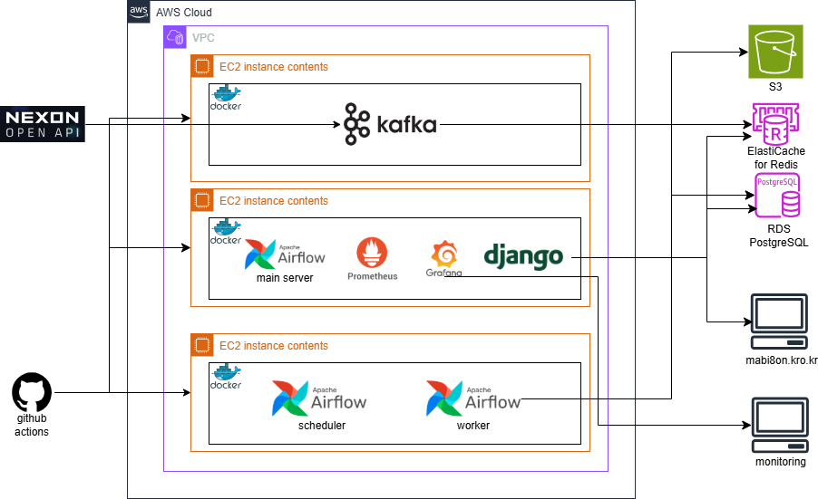
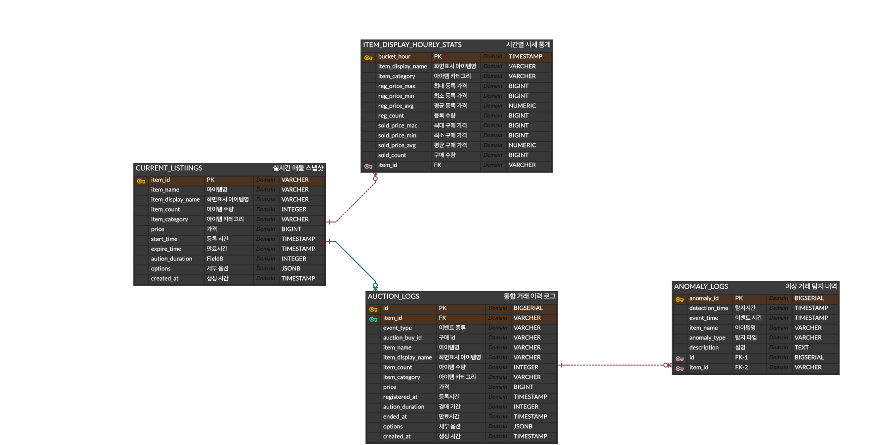
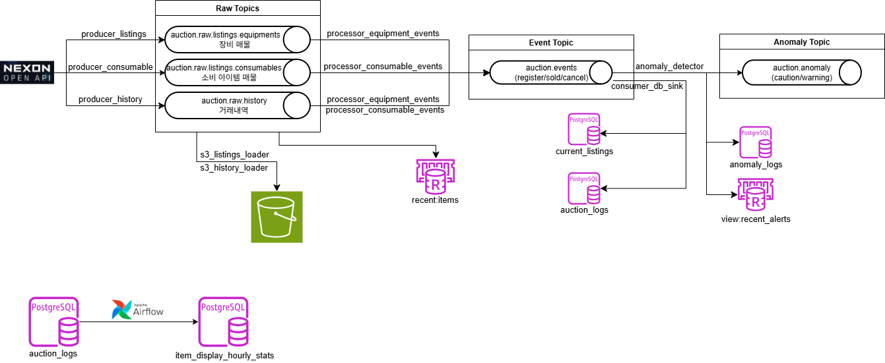
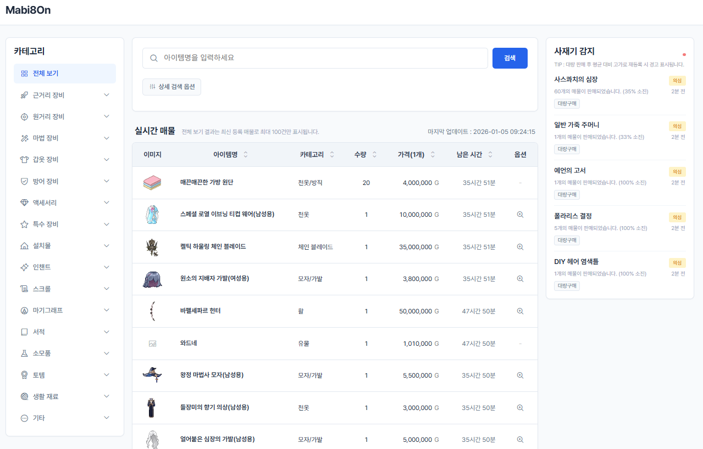
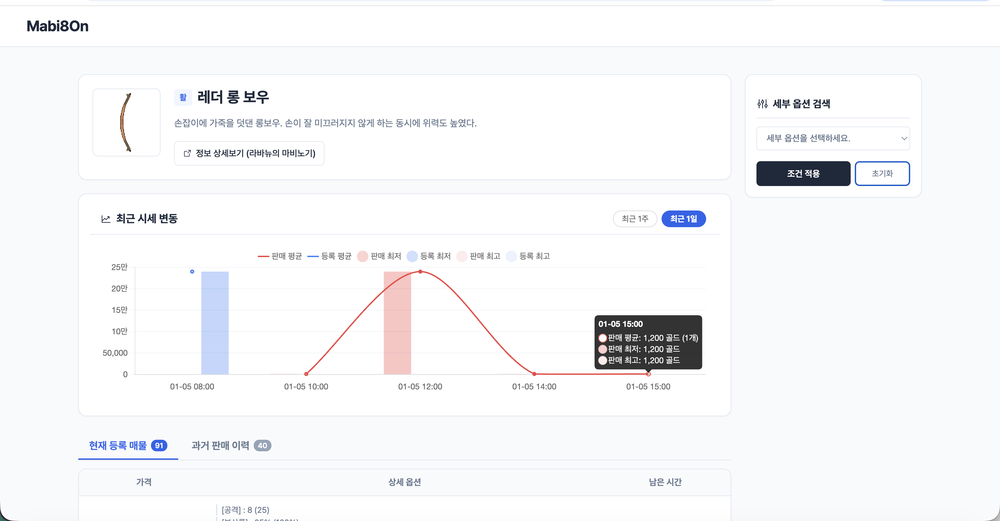

## Mabi-Auction: 마비노기 실시간 경매장 시세 조회 및 이상 탐지 서비스

마비노기 경매장 데이터를 **수집(Kafka) → 처리/이상탐지(Streaming) → 적재(PostgreSQL/S3) → 집계(Airflow) → 시각화(Django)** 하는 데이터 파이프라인/웹 서비스를 구축한 프로젝트입니다.

## 목차

- [프로젝트 소개](#프로젝트-소개)
- [프로젝트 구성](#프로젝트-구성)
- [데이터 파이프라인 상세](#데이터-파이프라인-상세)
- [역할 및 협업 방식](#역할-및-협업-방식)
- [프로젝트 폴더 구조](#프로젝트-폴더-구조)
- [최종 결과물](#최종-결과물)
- [모니터링](#모니터링)

## 프로젝트 소개

### 개요

본 프로젝트는 **NEXON Open API(마비노기 경매장)** 를 기반으로 거래/매물 데이터를 주기적으로 수집하고, Kafka 스트리밍 처리로 **이벤트(등록/판매/취소)와 이상 거래(사재기·시세조작 의심)** 를 탐지합니다.

최종적으로 사용자는 Django 웹에서:

- **실시간 매물/시세 탐색**
- **아이템 상세(옵션/설명/가격 흐름)**
- **사재기/이상 거래 알림 리스트**

를 확인할 수 있습니다.

### 프로젝트 목적

- **Kafka 기반 실시간 데이터 수집/이벤트화 파이프라인** 설계
- **이상 탐지(사재기/시세조작 의심) 알고리즘**을 스트림 처리로 적용
- **Airflow**로 배치 집계(통계 테이블) 자동화
- **Django UI**로 경매장 데이터/경고 신호를 사용자에게 제공
- **Prometheus + Grafana**로 운영 모니터링 체계 구축

### 기획 의도(문제 정의)

- **이상 거래(사재기/시세 조작)** 를 일반 유저가 사전에 파악하기 어려워 예상치 못한 피해가 발생
- 비정상 거래 패턴을 **실시간으로 감지·추적**할 수 있는 시스템 부재
- 커뮤니티 소문이 아닌 **신뢰할 수 있는 데이터 기반 지표** 제공 서비스 필요

## 프로젝트 구성

### 기술 스택

- **Data Ingestion/Streaming**: Apache Kafka
- **Workflow**: Apache Airflow
- **Storage**: PostgreSQL(RDS), AWS S3(원본)
- **Backend/UI**: Django, Redis(캐시/실시간 키)
- **Monitoring**: Prometheus, Grafana
- **Infra**: AWS EC2 / RDS / ElastiCache

### 시스템 아키텍처(요약)
#### 1) 그림



```text
NEXON Open API
  └─ (Producers) kafka_auction/collector  →  Kafka Raw Topics
        └─ (Processors) events 생성 + Redis 캐시  →  Kafka Events Topic
              ├─ (DB Sink) PostgreSQL 적재 (mabi_raw.*)
              ├─ (Anomaly Detector) 이상탐지 → PostgreSQL(mabi_raw.anomaly_logs) + Redis(view:recent_alerts)
              └─ (S3 Loader) Raw jsonl(.gz) 적재

Airflow(@hourly) → mabi_analytics.item_display_hourly_stats 갱신
Django → 실시간 목록(주로 Redis) + 검색/차트/상세(주로 PostgreSQL/analytics) 제공
```

### 데이터 소스

| 소스 | 데이터 |
| --- | --- |
| NEXON Open API | 경매장 매물 리스트, 거래 내역(최근 1시간) |

주요 엔드포인트(기본값은 `kafka_auction/config/settings.py` 참조):

- `GET /mabinogi/v1/auction/list`
- `GET /mabinogi/v1/auction/history`

### 데이터 모델




| 테이블 | 용도 |
| --- | --- |
| CURRENT_LISTINGS | 현재 경매장에 등록된 활성 매물의 실시간 상태를 보관하는 스냅샷 테이블 |
| AUTION_LOGS | 아이템의 이벤트(등록, 판매, 취소)를 시계열로 기록하는 원천 로그 테이블 |
| ITEM_DISPLAY_HOURLY_STATS | `AUCTION_LOGS`를 바탕으로 1시간 단위로 집계된 아이템별 통계 데이터 테이블 |
| ANONMALY_LOGS | 모든 적재 레이어에서 감지된 비정상 데이터(사재기, 덤핑 시세 등)를 독립적으로 기록하는 테이블 |

### Kafka 토픽(기본값)

기본값은 `kafka_auction/config/settings.py`에 있으며, 운영에서는 `.env`로 관리합니다.

| 용도 | 환경변수 |
| --- | --- |
| 장비 매물(raw) | `KAFKA_TOPIC_LISTINGS_EQUIPMENTS` |
| 소모품 매물(raw) | `KAFKA_TOPIC_LISTINGS_CONSUMABLE` |
| 거래 내역(raw) | `KAFKA_TOPIC_RAW_HISTORY` |
| 이벤트 토픽 | `KAFKA_TOPIC_EVENTS` |
| 이상 알림 토픽 | `KAFKA_TOPIC_ANOMALY` |

## 데이터 파이프라인 상세

### 1) 데이터 흐름도


### 2) 데이터 수집(Collector)

- `kafka_auction/collector/producer_listings.py`: 장비 매물 수집 → raw 토픽 적재
- `kafka_auction/collector/producer_consumable.py`: 소모품 매물 수집 → raw 토픽 적재
- `kafka_auction/collector/producer_history.py`: 거래 내역 수집 → raw 토픽 적재

모든 Collector는 `next_cursor` 기반 페이지네이션을 반복하며, Kafka로 JSON payload를 전송합니다.

### 3) 이벤트 처리(Processor)

- `kafka_auction/processor/processor_equipment_events.py`
- `kafka_auction/processor/processor_consumable_events.py`

역할:

- raw 매물/거래 토픽을 소비해 **REGISTER/SOLD/CANCEL** 이벤트를 구성
- 중복/지연/초기 동기화 구간을 고려해 `skip_anomaly_detection`, `is_ghost` 플래그를 부여
- Django 메인 화면을 위한 실시간 캐시 키를 Redis에 갱신(예: `recent:items`)

### 4) 이상 탐지(Anomaly Detector)

- `kafka_auction/processor/anomaly_detector.py`

역할:

- events 토픽을 입력으로 받아 윈도우 기반 지표를 갱신(`kafka_auction/processor/window_buffer.py`)
- 급격한 소진(대량 구매) 또는 평균 대비 고가 등록 등 **이상 징후**를 탐지
- 탐지 결과를:
  - PostgreSQL: `mabi_raw.anomaly_logs`
  - Redis: `view:recent_alerts` (Django 사이드바/알림)
  - Kafka: anomaly 토픽(선택적 연계)
  로 전달

### 5) 적재(Storage)

- **PostgreSQL(RDS)**: `kafka_auction/sink/consumer_db_sink.py`가 `mabi_auction.current_listings`, `mabi_auction.auction_logs`로 배치 적재
- **S3**: `kafka_auction/sink/s3_listings_loader.py`, `kafka_auction/sink/s3_history_loader.py`가 raw 토픽을 `.jsonl.gz`로 업로드(시간 파티셔닝)

### 6) 배치 집계(Airflow)

- DAG: `airflow/dags/mabi_item_stats_dag.py` (`@hourly`)
- 결과: `mabi_analytics.item_display_hourly_stats`
- SQL: `airflow/dags/sql/*`

## 역할 및 협업 방식

### 역할 분담

| Github ID | 담당 |
| --- | --- |
| Minji-Ko-68 | Kafka 설계 및 관리, 발표 |
| dongyi97 | Kafka 설계 및 관리, GitHub 정리 |
| seeany22 | AWS 인프라 설계 및 관리, 보고서 작성 |
| ChoiHyukJoo | AWS 인프라 관리, 발표 PPT 작성 |

### 협업 방식

| 툴 | 활용 방식 |
| --- | --- |
| GitHub | 이슈 기반 개발 → 브랜치 전략 → PR 후 `dev` 병합 |
| Slack | 오류 공유, 수집 이슈 해결, 일정 조율 |
| Notion / Zep | 기획/매뉴얼/ETL 흐름 문서화 및 자료 공유 |
| 정기 회의 | 테이블/범위/로직 협의 및 의사결정 기록 |

## 프로젝트 폴더 구조

```text
Mabi-Auction/
├── kafka_auction/                 # Kafka 기반 수집/처리/적재(Streaming)
│   ├── collector/                 # Producers (NEXON Open API → Kafka)
│   ├── processor/                 # 이벤트 처리 + 이상탐지
│   ├── sink/                      # DB/S3 적재
│   ├── db/                        # DB 스키마 초기화 SQL
│   └── config/                    # 설정 로드
├── airflow/                       # Airflow DAG 및 SQL(집계)
│   └── dags/
├── django/                        # Django 웹(UI/API)
│   └── Mabinogi_Auction_Web/
├── aws/                           # 로컬 통합 테스트/인프라 관련 자료
│   └── local_test/
├── data/sample/                   # 샘플 데이터
├── scripts/                       # 크롤러/유틸
├── docker-compose.yaml            # Kafka + 파이프라인 서비스(EC2용)
├── Dockerfile                     
└── README.md
```

## 최종 결과물

### 1) 메인화면


### 2) 상세화면


## 모니터링

- **Prometheus**: EC2/Kafka/Airflow/Django 메트릭 수집
- **Grafana**: CPU/메모리 부하, Kafka Lag, Airflow Task 상태 대시보드

